# Quietype

> A quiet WordPress theme for thoughtful reading.

Quietype 是一款面向中文长文与技术写作的经典 WordPress 主题。简约、明亮，兼顾桌面与手机阅读；集成年度书架、轻量图库和项目展示，适合个人博客。

[在线演示](https://taifua.com/) · [版本发布](https://github.com/taifuer/quietype/releases) · [更新记录](CHANGELOG.md) · [开发复盘](BUILDING-QUIETYPE.md)

## 页面预览

| 首页 | 关于 |
| --- | --- |
| 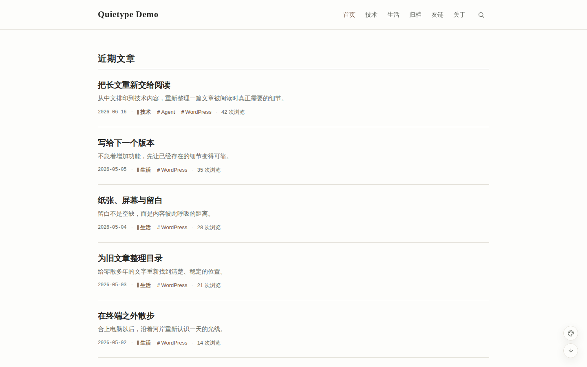 | 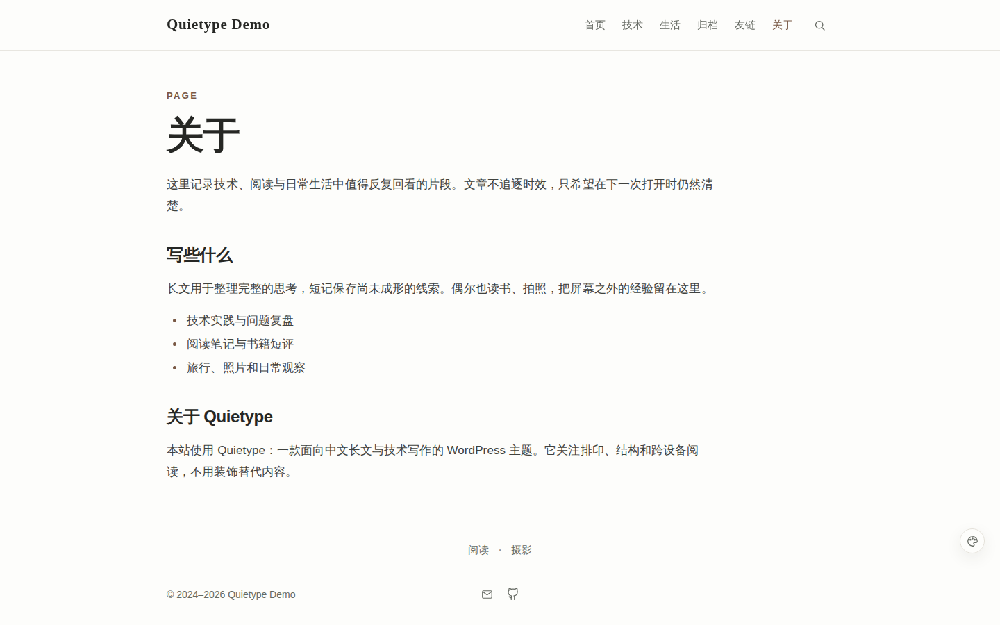 |

| 文章排版 | 代码与公式 |
| --- | --- |
| 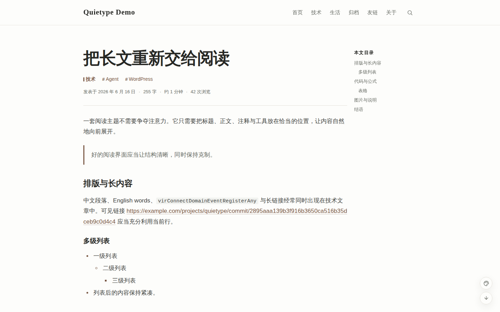 | 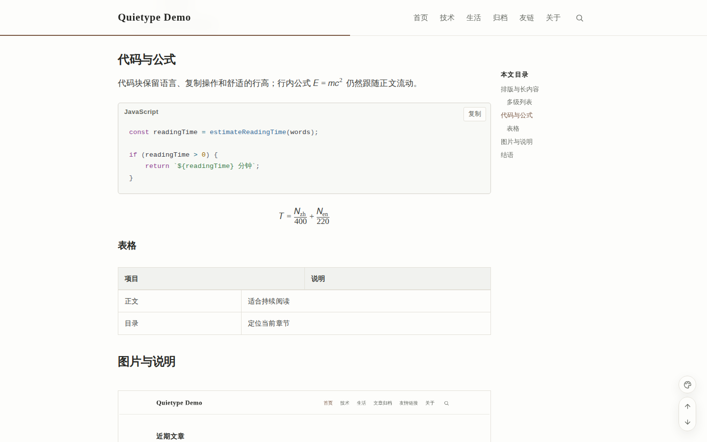 |

| 文章归档 | 友情链接 |
| --- | --- |
| 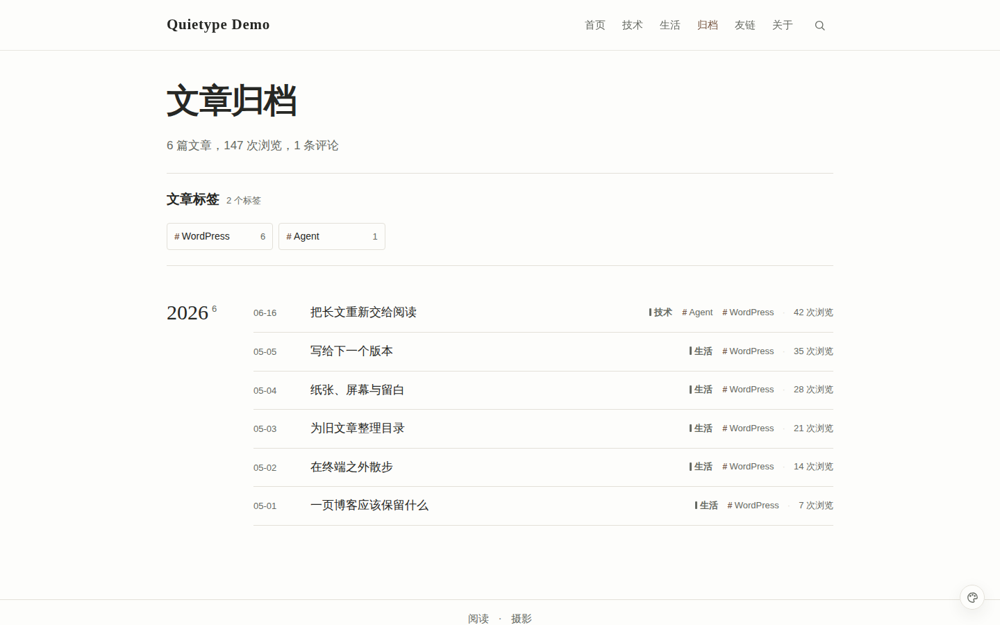 | 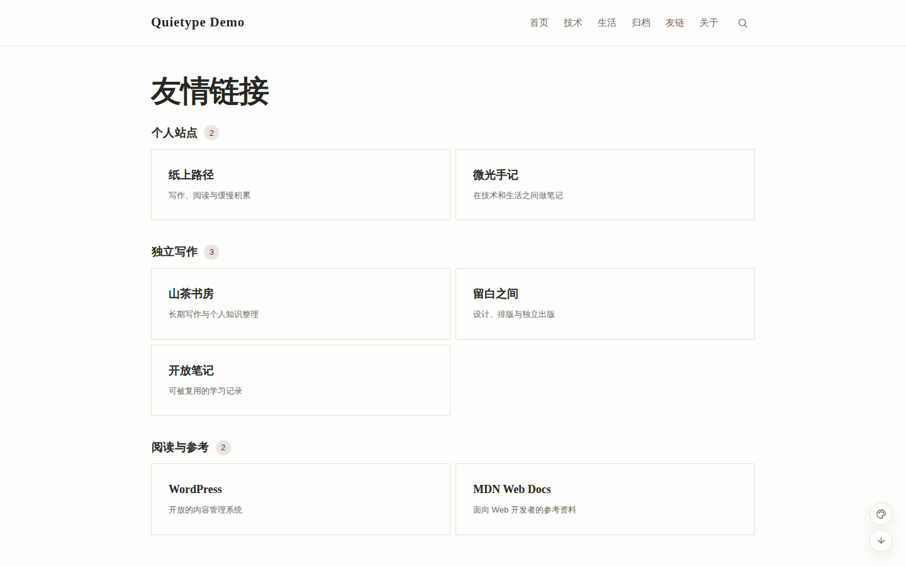 |

| 年度书架 | 年度照片 |
| --- | --- |
| 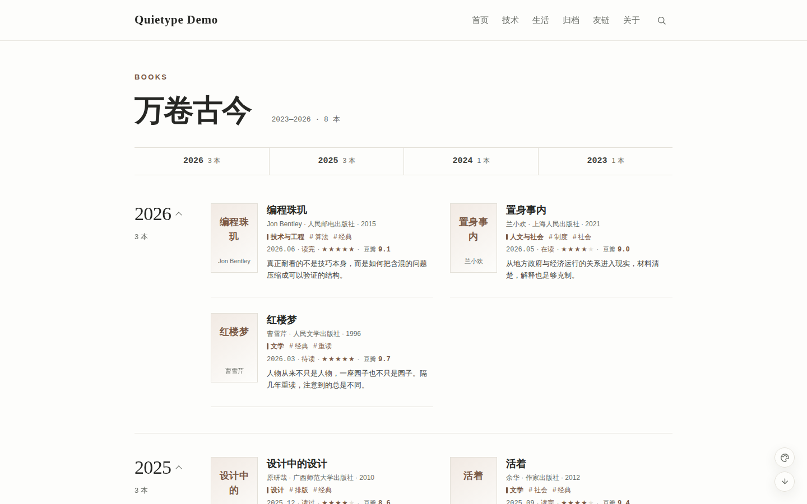 | 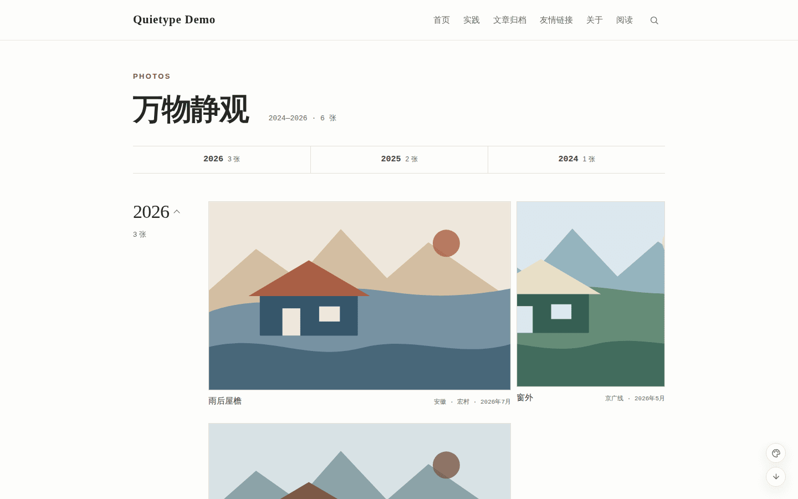 |

<details>
<summary>查看移动端页面</summary>

| 首页 | 文章 | 归档 |
| --- | --- | --- |
| 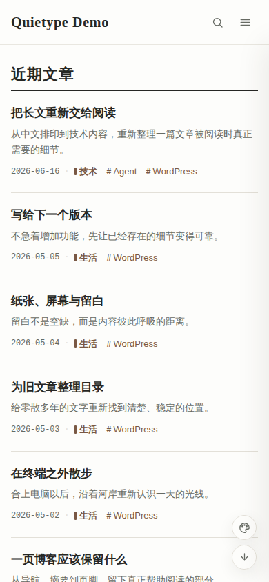 | 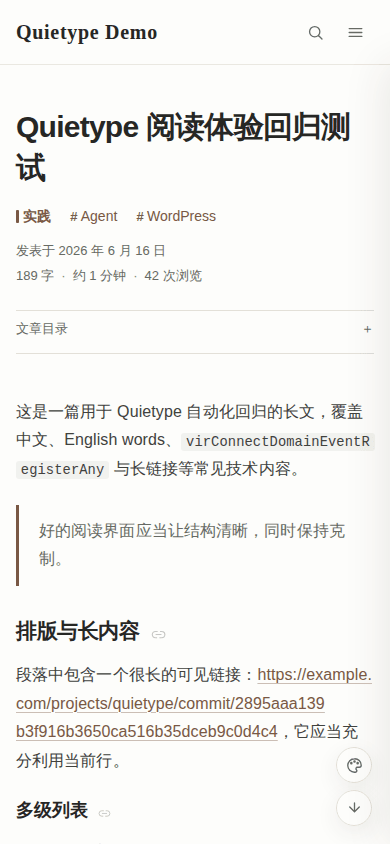 | 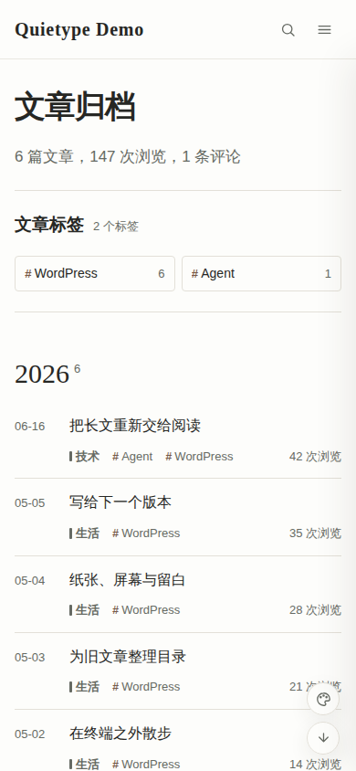 |

</details>

演示图使用固定测试内容，照片来源与许可见[素材说明](tests/fixtures/photos/README.md)。

## 主要能力

### 阅读与交互

- 中英文系统字体、克制的标题层级，以及纸白、米杏、浅绿三种亮色阅读背景
- H2/H3 自动目录、章节永久链接、阅读进度；桌面长目录省略显示并跟随当前章节，移动端阅读中可随时打开目录
- 固定移动 Header、抽屉导航、搜索、背景切换与返回顶部工具
- 亮色代码配色、语言标记、行号、复制按钮和按需换行，宽表格独立横向滚动
- 兼容 WP Editor.md 的代码高亮与公式；主题负责阅读样式、Mermaid 图表和 Markdown 提示块，**不内置 Markdown 编辑器或解析器**
- `[!CAPTION]` 图片与表格题注，支持原生题注、灯箱说明、RSS 与自动摘要；正文外链图片按 WordPress 原生策略延迟加载
- 响应式图片、打印样式及按需加载的 PhotoSwipe 图片预览；不加载网络字体
- 首页、文章、分类、标签、搜索、年度归档、友链、关于与 404 模板

### 内容与管理

- `/books/` 年度书架：分类、标签、短评、阅读状态、评分及可选资料链接
- `/photos/` 轻量图库：外链图片、缩略图、拍摄信息、年度折叠及原图入口
- `/projects/` 项目展示：截图预览、简介、可编辑类型与默认类型，可选在线链接、源码、开源状态和主要语言
- 可配置文章版权声明、浏览量、友链状态、SMTP、轻量 SEO 与隐私说明
- 自定义登录入口、评论验证及面向单作者站点的 WordPress 常用优化
- 普通文章使用 WordPress 原有内容存储，不引入主题私有短代码

## 环境与安装

- WordPress 6.6+
- PHP 8.0+

推荐从 [GitHub Releases](https://github.com/taifuer/quietype/releases) 下载 `quietype-<版本号>.zip`，然后在 WordPress 后台进入“外观 → 主题 → 安装主题 → 上传主题”。发布包已经包含顶层 `quietype/` 目录。

也可以直接安装开发版本：

```bash
cd wp-content/themes
git clone https://github.com/taifuer/quietype.git
```

启用后建议依次完成：

1. 在“外观 → 菜单”分配顶部主导航；需要时再分配正文之后的页尾上方导航。
2. 创建 `/archive/` 页面并指定“文章归档”模板；友链页指定“友情链接”模板。
3. 在“外观 → Quietype 设置”配置站点信息、内容页面、SEO、访问、安全和邮件。
4. 访问“设置 → 固定链接”并保存一次，使 `/books/`、`/photos/` 与 `/projects/` 路由生效。

完整字段、缓存、登录保护、SMTP、书籍、照片和项目配置见 [配置指南](docs/CONFIGURATION.md)；题注、图表、提示块与技术文章写法见 [技术内容指南](docs/READING.md)。

## 内容与数据

Quietype 使用 WordPress 数据库存储书籍、照片、项目、浏览量和主题选项。切换主题不会删除这些数据或普通文章正文，但集成内容的管理入口与归档路由会暂停注册，重新启用后恢复。集成类型使用 `book`、`photo`、`project`、`book_category`、`book_tag` 和 `project_type` 标识，安装注册同名类型的插件前请先检查冲突。

主题没有遥测或广告脚本。启用头像镜像、友链检测、SMTP、远程图片或自定义统计后，站点可能产生相应的外部请求；请在隐私政策中据实说明。部署或迁移前始终备份数据库与 `wp-content/uploads`。

## 本地开发

主题没有前端构建步骤，将仓库放入 WordPress 的 `wp-content/themes/quietype` 即可开发。自动化测试另用隔离环境，不连接线上数据库，需要 Node.js 22.22+（或 24.8+）与 Docker Compose：

<details>
<summary>测试命令</summary>

```bash
npm ci
npm run env:start
npm run env:seed
npm run env:check
npm run test:js
npm run test:e2e
npm run test:performance
npm run env:plugins
npm run test:integration
npm run env:stop
```

`env:plugins` 安装固定版本的 WP Editor.md，验证真实 Markdown 渲染；放在无插件的视觉与性能检查之后运行。测试结束务必执行 `env:stop`，它只清理隔离测试环境。

有 PHP 和 Composer 时，还可以运行：

```bash
composer install
composer lint -- --warning-severity=0
find . -maxdepth 2 -name '*.php' -exec php -l {} \;
git diff --check
```

GitHub Actions 检查 PHP/WordPress 兼容性、浏览器交互、视觉、可访问性、性能与依赖安全。资源体积仅记录，不设严格大小门槛。发布时校验 `style.css`、`functions.php`、`package.json` 与版本标签一致，再生成可安装 ZIP。

</details>

## 鸣谢

Quietype 在研究阶段参考了不同生态中优秀阅读主题与独立博客的信息层级、中文排版和交互取舍，包括 [Retypeset](https://retypeset.radishzz.cc/)、[Hugo PaperMod](https://adityatelange.github.io/hugo-PaperMod/)、[Hugo Stack](https://demo.stack.cai.im/)、[Adams](https://github.com/Tokinx/Adams)、[writings.sh 存档](https://web.archive.org/web/20250807154239/https://writings.sh/)以及 [Typora 主题库](https://theme.typora.io/)。搬砖日记、笔记、三迹、Moeyua、Joway、Halo 主题商店和 NiceTheme 等站点与主题生态，也帮助我们比较了阅读密度、归档方式和后台能力。完整参考清单及具体经验见[开发复盘](BUILDING-QUIETYPE.md#六参考与鸣谢)。

主题建立在 [WordPress](https://wordpress.org/) 之上，图片预览使用 [PhotoSwipe](https://photoswipe.com/)，技术图表使用 [Mermaid](https://mermaid.js.org/)，兼容 [WP Editor.md](https://wordpress.org/plugins/wp-editormd/)、Prism 与 KaTeX；自动化质量体系使用 Playwright、axe-core、Lighthouse CI、html-validate 与 WordPress Coding Standards。感谢这些项目及其维护者。Quietype 没有复刻某个主题，仓库内直接分发的第三方代码及许可均单独保留。

## 许可证

Quietype 基于 [GNU General Public License v2 or later](LICENSE.txt) 发布。主题内置 [PhotoSwipe 5.4.4](assets/vendor/photoswipe/LICENSE) 与 [Mermaid 11.17.2](assets/vendor/mermaid/LICENSE)，依各自 MIT License 分发；Mermaid 的来源、校验值和捆绑许可说明见[依赖记录](assets/vendor/mermaid/README.md)。
