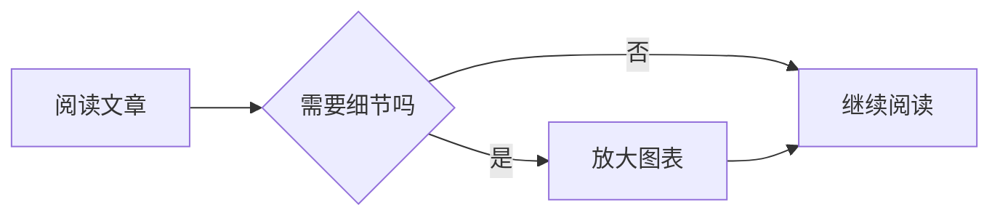

# 技术内容与阅读交互

Quietype 的阅读增强作用于输出 HTML，不批量改写已保存的文章。技术内容使用 Markdown 结构与轻量标记，不需要主题短代码。

## 可选的内置 Markdown（试用）

在“外观 → Quietype 设置”启用“内置 Markdown”，默认关闭。**先备份，再停用 WP Editor.md**；如果它仍启用，主题模块暂停接管，防止重复解析。没有新插件需要安装。

- 新文章/页面使用 WordPress 自带的 CodeMirror（关闭语法着色偏好时回退到普通文本框），提供编辑、分栏与预览，以及媒体库插图和常用语法按钮。保留 WordPress 发布、自动保存、修订、分类和标签界面。
- 带 WP Editor.md 标记且保留 `post_content_filtered` 原文的旧文章可直接编辑；普通 HTML / 区块文章不自动转换。**打开编辑器不会改写数据库，只有保存才重新生成 HTML。** 旧插件的非标准扩展、短代码或复杂原始 HTML 请逐篇预览验证，不保证所有历史语法完全一致。
- PHP Markdown Extra 负责标题、嵌套列表、表格、脚注等；主题补充删除线、`$…$` / `\(…\)` 行内公式、`$$…$$` / `\[…\]` 独立公式，以及 `math` / `latex` / `katex` 围栏。Mermaid、提示块、题注使用现有阅读样式；题注仍需空一行。
- 旧文章无需重新保存即可显示公式：输出时先保护 LaTeX，再处理标点和长词断行，不改写数据库。代码、链接地址和 HTML 属性中的美元符号不会当作公式；普通文字中的字面美元符号请写成 `\$`。
- 编辑器预览与保存使用同一服务端解析器，输出经过 WordPress HTML 白名单过滤；预览不执行第三方短代码、统计脚本。完整页面效果及第三方短代码使用 WordPress 原生“预览”检查。
- `post_content_filtered` 保存原文，`post_content` 保存标准 HTML。访客不执行 Markdown 解析，只有含代码/公式的内容加载本地 Prism / KaTeX。关闭模块后 HTML 仍可阅读；修改过 HTML 的文章不会被旧原文自动接管，旧原文仍保留在数据库中以供恢复。切换其他主题后，公式/图表需对应渲染器。

先在本地或预发布站验证旧文章，再考虑停用生产站插件。该模块目前仅用于文章和页面，不接管评论、书籍或照片。

## 目录与宽内容

使用 H2/H3 建立章节层级即可生成目录。桌面目录长标题单行省略，悬停或键盘聚焦显示全文；滚动正文时，当前章节会在目录自己的滚动区内跟随。手机和窄屏保留正文前的原生折叠目录，滑过它后，右侧工具区出现目录按钮，点击可定位其他章节。

普通表格的表头、表身共享列宽；确实过宽的表格可以在容器内滚动，键盘用户可以聚焦后用方向键操作。代码同样默认横向滚动，仅超宽代码出现“换行”按钮。换行只改变显示，不改变复制内容；Prism 行号会跟随调整。

## 图片与表格题注

在独立图片或表格之后留一个空行，添加单独一段 `[!CAPTION] 说明`：

```markdown


[!CAPTION] 图 1：**系统整体架构**，参考[设计说明](https://example.com/design)。

| 方案 | 特点 |
| --- | --- |
| 方案 A | 部署简单 |
| 方案 B | 扩展方便 |

[!CAPTION] 表 1：两种方案的对比
```

- 图片生成 `<figure>` / `<figcaption>`，题注显示在图片下方；表格生成原生 `<caption>`，标题显示在表格上方。书写位置统一放在对应内容之后。
- “图 1 / 表 1”可手动填写，也可以只写描述，不自动编号。允许加粗、斜体、行内代码和链接等简单排版；不允许题注引入脚本、事件属性或可执行链接。
- 图片必须独立成段，也可以是链接图片或单个 `<picture>`；段内图片、多图同段、代码示例及没有紧邻图片/表格的标记不转换。已有 WordPress 原生题注保持不变，不自动把 `alt` 或 `title` 当作题注。
- 题注由服务端输出，无 JavaScript 时也可阅读，并随正文进入 RSS 与自动摘要。点击图片放大时，新题注与原生图片题注都会以纯文本显示；来源链接在正文中保留。
- 这是 Quietype 的扩展标记，不是通用 Markdown 标准。WP Editor.md 的编辑器预览不会自动呈现同样样式，切换主题后可能显示原始标记。原生 WordPress 编辑器也可在图片段落或 HTML 表格之后添加带该标记的普通段落；已有图像区块请直接填写原生题注。

正文外链图片的已知尺寸在 WordPress 加载优化之前补齐，让 Core 按其首屏判断添加 `loading` / `fetchpriority`，并保留作者显式设置。尺寸信息仍由已有后台任务获取，访客请求不抓取远程图片信息；未知尺寸不伪造。照片页的按年加载与灯箱机制不受此处理影响。

## 原生视频

使用 WordPress 标准短代码，单独成段、前后空一行；不需要 Plyr 等播放器插件：

```text
[video src="https://example.com/demo.mp4" poster="https://example.com/cover.jpg" title="操作演示"]
```

- `src` 必填，支持 HTTP(S) 的 MP4 / M4V、WebM、OGV 文件链接（含查询参数）；不是视频网站的观看页。`poster` 封面、`title` 无障碍名称均可省略。也可用 `mp4="…" webm="…"` 提供多种格式。编码是否能播放由浏览器决定，通常优先使用 H.264/AAC 的 MP4。
- 浏览器原生控制栏提供播放、进度、音量和全屏。默认不自动播放、`preload="none"`，不提前下载整段文件，也不加载播放器 JS/CSS；预加载策略最终由浏览器决定。封面会正常请求，建议使用压缩图片。
- 播放器不会超出正文，保持视频/封面的自然比例，不强制 16:9。如已知原始尺寸，可加 `width="1464" height="416"`。原始 HTML `<video>` 同样有响应式宽度约束。
- 内置 Markdown 的“视频”按钮可插入模板，分栏预览支持播放；正文代码示例、HTML 属性和注释中的标记不执行。普通文字中需要展示标记时可写成 `[[video src="…"]]`。其余第三方短代码仍仅在 WordPress 整页预览中执行。
- 主题不注册 `[plyr]` 兼容层。旧内容需先备份，将原文和已保存正文中的 `[plyr poster="封面"]视频地址[/plyr]` 替换成标准 `[video]`，再停用旧播放器插件。关闭 Markdown 模块不影响视频；切换主题后，标准短代码仍可由 WordPress 播放。

大文件建议放在支持 Range 请求的对象存储/CDN；不代理或转码视频，不支持直播、HLS/DASH、自定义播放器皮肤。原生视频控制栏无需 JavaScript；网络和编码错误由浏览器处理。

## Mermaid 图表

在支持 Markdown 的编辑器中填写：

````markdown

````

也可以使用 `sequenceDiagram`、`classDiagram` 等 Mermaid 语法。原生 WordPress 不解析 Markdown 围栏：区块编辑器请使用自定义 HTML 块中的 `<pre class="mermaid">…</pre>`，或使用能输出 `code.language-mermaid` 的 Markdown 编辑器。HTML 块内的 `<`、`>`、`&` 需按 HTML 规则转义。

- 主题设置的 Mermaid 开关默认开启。WP Editor.md 的前台旧渲染器会被停用，编辑器预览不受影响。
- 只有含图表的文章/页面加载入口脚本；完整 Mermaid 库在图表距视口约 600px 时从本站加载，不依赖运行时公共 CDN。
- 图表使用纸白、米杏、浅绿对应的亮色配色。“放大查看”优先保留可读字号，宽图可滚动查看；“适应屏幕”可以查看全图，另有缩放按钮。按 Esc 或关闭按钮返回正文。
- 每张图保留可展开的源码；下载失败或语法错误时直接显示源码，其余正文与图表继续工作。关闭 JavaScript 时也保留服务端输出的源码。
- 使用固定 `strict` 安全级别；正文内配置不能放宽安全边界。HTML 交互和点击回调禁用，单图最多 50,000 字符、500 条边。大型架构图宜拆为多张，避免难读和长时间布局计算。
- 官方完整浏览器包约 3.6 MB（未压缩传输前），并非零成本组件。部署时应为 JavaScript 开启 gzip/Brotli；不含图表的页面不会请求该库。

语法、可访问性描述与配置参考 [Mermaid 官方文档](https://mermaid.js.org/config/usage.html)。可以在图中提供 `accTitle` / `accDescr` 为读屏软件补充信息。

## 提示块

主题识别以 `[!NOTE]`、`[!TIP]`、`[!IMPORTANT]`、`[!WARNING]`、`[!CAUTION]` 开始的引用块，分别显示“说明、提示、重要、注意、警告”：

```markdown
> [!NOTE]
> 这是与当前论述相关的补充说明。
```

普通引用不变。不建议连续堆叠提示块；经典 Markdown 解析器可能合并相邻引用，确需分开时在两块之间插入独立一行的 `<!-- -->`。

## 回归验证

先运行无插件的常规回归与 Lighthouse，然后执行 `npm run env:markdown`、`npm run test:markdown` 检查内置模块，最后执行 `npm run env:plugins`、`npm run test:integration` 检查切回 WP Editor.md。测试只在一次性的本地容器中安装固定版本插件并生成测试文章；不使用线上数据，也不会修改生产站点。

测试覆盖两种视口、图片/表格题注、原生题注与代码保护、RSS/摘要、图片延迟请求与灯箱切换、原生视频宽度/延迟加载/播放、无 JavaScript/打印、表格对齐、Prism 自动加载/行号/复制、KaTeX、目录截断/跟随/跳转、图表缩放/换色、无网络回退、恶意标签与可访问性。内置 Markdown 另检查旧公式边界、Shell 美元符号、纯公式及视频预览、编辑保存和本地自动备份恢复；PHP 权限、自动保存、修订与切换检查使用 `npm run env:check`。结束后使用 `npm run env:stop` 清理隔离容器。
