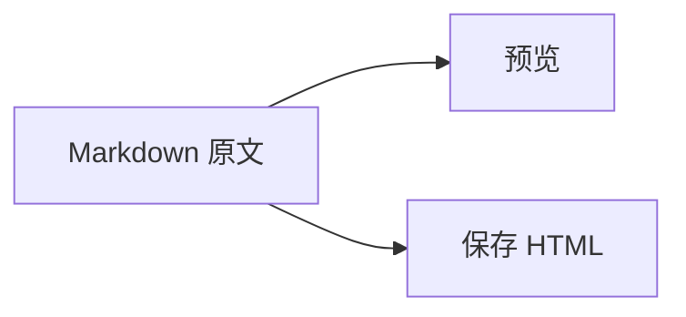

## 一份可以继续编辑的原文

**中文与 English** 混排，*重点*、~~过时内容~~、行内代码 `virConnectDomainEventRegisterAny` 和[普通链接](https://example.com/)。脚注也保留。[^note]

> [!NOTE]
> 预览与保存共用解析器，不批量修改其他文章。

## 代码与图表

```python
def hello(name):
    print(f"你好，{name}")

hello("Quietype")
```



## 公式与表格

行内公式 $E = mc^2$，下标 $a_i + b_j$，另一个分隔形式 \(x^2 + y^2\)。金额 \$20 不应变成公式。代码中的 `$literal$` 不处理。

转义分隔符 \$not_math\$ 保持文字，价格 $20 和 $30 也不解析。

$$
\int_0^1 x^2\,dx = \frac{1}{3}
$$

```math
\begin{pmatrix} a & b \\ c & d \end{pmatrix}
```

| 功能 | 原文 | HTML |
| --- | --- | --- |
| 编辑 | 保留 | 保存生成 |
| 阅读 | 不现场解析 | 直接输出 |

[!CAPTION] 表 1：内容保存方式


[!CAPTION] 图 1：**图与说明**一起预览

[^note]: 这是 Markdown Extra 的脚注。
